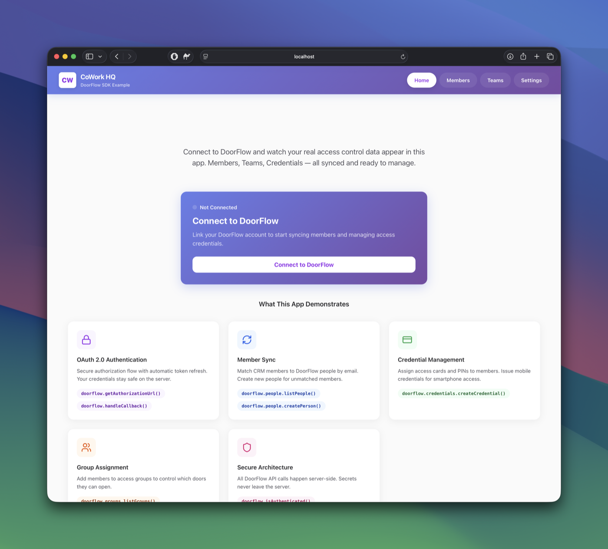

# DoorFlow Ruby Sample Application

A sample Rails application demonstrating DoorFlow API integration. While this example uses a fictional coworking space ("CoWork HQ"), the patterns apply to any system that manages people and access — gyms, offices, universities, property management, etc.

Built for developers integrating DoorFlow into their applications.

See how easy it is to develop on DoorFlow. Get up and running in minutes.



## What This Demonstrates

- **OAuth 2.0 Flow** — Secure authorization with automatic token refresh
- **Member ↔ People Sync** — Match CRM members to DoorFlow people by email, create missing records
- **Group-Based Access** — Map CRM teams to DoorFlow groups for door access control
- **Server-Side Security** — All API calls happen in Rails controllers, secrets never reach the browser
- **Credential Management** — Issue cards, PINs, and mobile credentials

## Prerequisites

- Ruby 3.2+
- Rails 8.0+
- A DoorFlow developer account
- OAuth application credentials from [developer.doorflow.com](https://developer.doorflow.com/applications) in a 'Testing' state.

## Quick Start

```bash
cp .env.example .env    # then add your DoorFlow credentials
bundle install
bin/rails db:setup      # creates demo members and teams
bin/dev
```

Open [http://localhost:3333](http://localhost:3333) — the app will guide you through connecting to DoorFlow.

## Configuration

Copy `.env.example` to `.env` and fill in your credentials:

```bash
# .env
DOORFLOW_CLIENT_ID=your_client_id_here
DOORFLOW_CLIENT_SECRET=your_client_secret_here
DOORFLOW_REDIRECT_URI=http://localhost:3333/api/auth/callback
```

Get your credentials from [developer.doorflow.com/applications](https://developer.doorflow.com/applications). When creating your OAuth application, set the redirect URI to `http://localhost:3333/api/auth/callback`.

## SDK Usage

This app uses the official [`doorflow-api`](https://rubygems.org/gems/doorflow-api) SDK with the client-instance pattern for thread-safe, multi-tenant support.

### Initialize the Client

```ruby
require 'doorflow-api'

# Set up OAuth authentication
auth = DoorFlow::Auth::DoorFlowAuth.new(
  client_id: ENV['DOORFLOW_CLIENT_ID'],
  client_secret: ENV['DOORFLOW_CLIENT_SECRET'],
  redirect_uri: 'http://localhost:3333/api/auth/callback',
  storage: DoorFlow::Auth::FileTokenStorage.new('./data/tokens.json')
)

# Create a client with your auth object
client = DoorFlow::Client.new(auth: auth)
```

### OAuth Flow

```ruby
# Start authorization (with PKCE)
url, state, code_verifier = auth.authorization_url(
  scopes: ['account.person', 'account.channel.readonly', 'account.event.access.readonly'],
  use_pkce: true
)

# Handle callback
auth.handle_callback(
  code: params[:code],
  state: params[:state],
  expected_state: session[:oauth_state],
  code_verifier: session[:code_verifier]
)

# Check connection
connected = auth.authenticated?

# Disconnect
auth.disconnect
```

### People

```ruby
# List all people
people = client.people.list

# Find by email
result = client.people.list(email: 'alice@example.com')
person = result.data.first

# Create a person with photo
person = client.people.create(
  first_name: 'Alice',
  last_name: 'Smith',
  email: 'alice@example.com',
  department: 'Engineering',
  job_title: 'Software Developer',
  group_ids: [1, 2],
  image_base64: 'iVBORw0KGgo...' # Base64-encoded image
)

# Update group assignments
person = client.people.retrieve(123)
person.update(group_ids: [1, 2, 3])
```

### Credentials

```ruby
# List credential types
types = client.credential_types.list

# Create a card credential
credential = client.credentials.create(
  person_id: 123,
  credential_type_id: 1,
  value: '12345678' # Card number
)

# Create a PIN (auto-generate)
credential = client.credentials.create(
  person_id: 123,
  credential_type_id: 2,
  value: '******' # Auto-generates PIN
)

# Create mobile credential (invitation sent to email)
credential = client.credentials.create(
  person_id: 123,
  credential_type_id: 3
  # No value needed - invitation sent to person's email
)

# Delete credential
credential = client.credentials.retrieve(credential_id)
credential.delete
```

### Groups

```ruby
# List all groups
groups = client.groups.list
```

## Architecture

### Team → Group Mapping

Teams provide an abstraction layer between your CRM and DoorFlow:

```
CRM Teams              DoorFlow Groups
┌─────────────┐        ┌─────────────┐
│ Engineering │ ─────► │ Tech Floor  │
└─────────────┘        └─────────────┘
┌─────────────┐        ┌─────────────┐
│ Sales       │ ─────► │ Sales Wing  │
└─────────────┘        └─────────────┘
┌─────────────┐        ┌─────────────┐
│ Executives  │ ─────► │ All Access  │
└─────────────┘        └─────────────┘
```

1. **Create Teams** — Define teams in your CRM (Engineering, Sales, etc.)
2. **Map to Groups** — Link each team to a DoorFlow group in Settings
3. **Assign Members** — Members can belong to multiple teams
4. **Sync** — During sync, members get assigned to DoorFlow groups based on their teams

Your CRM remains the source of truth; DoorFlow handles physical access control.

### Security

| Concern | Approach |
|---------|----------|
| Client Secret | Server-side only (Rails controllers), never exposed to browser |
| Access Tokens | Stored in `tmp/doorflow_tokens.json`, auto-refreshed with 5-min buffer |
| API Calls | All DoorFlow calls proxied through `/api/doorflow/*` routes |
| Thread Safety | Client-instance pattern (`DoorFlow::Client.new(auth:)`) for safe multi-tenant support |

> **Production note:** File-based token storage is fine for development, but in production you should store tokens in your database or Redis. The SDK accepts any storage adapter via the `storage:` parameter — see the [SDK README](../sdks/doorflow-sdk-ruby/README.md#token-storage) for examples.

## API Routes

### Application Routes

These are your app's internal routes for managing CRM data:

| Route | Method | Description |
|-------|--------|-------------|
| `/members` | GET/POST | List/create CRM members |
| `/members/:id` | GET/PATCH/DELETE | Member CRUD |
| `/teams` | GET/POST | List/create teams |
| `/teams/:id` | GET/PATCH/DELETE | Team CRUD |
| `/api/members/sync` | POST | Sync members to DoorFlow |
| `/api/reset` | POST | Factory reset to demo state |

### OAuth Routes

| Route | Method | Description |
|-------|--------|-------------|
| `/api/auth/connect` | GET | Start OAuth flow |
| `/api/auth/callback` | GET | OAuth callback |
| `/api/auth/status` | GET | Connection status + token info |
| `/api/auth/disconnect` | DELETE | Revoke tokens |
| `/api/auth/refresh` | POST | Force token refresh |

### DoorFlow Proxy Routes

These routes proxy requests to the DoorFlow API (secrets stay server-side):

| Route | Method | Description |
|-------|--------|-------------|
| `/api/doorflow/people` | GET | List DoorFlow people |
| `/api/doorflow/people/:id` | GET | Get single person |
| `/api/doorflow/people/:person_id/groups` | PUT | Update person groups |
| `/api/doorflow/credentials` | GET/POST | List/create credentials |
| `/api/doorflow/credentials/:id` | DELETE | Delete credential |
| `/api/doorflow/groups` | GET | List groups |

## Tech Stack

- **Framework**: Rails 8.0 (with Hotwire)
- **SDK**: [`doorflow-api`](https://rubygems.org/gems/doorflow-api)

## For Developers

This sample app includes `<DevNote>` components throughout the UI that explain implementation details, SDK usage, and architecture decisions. Look for the dark code-themed boxes when exploring the app.

## What's Next

This sample app covers request/response patterns — syncing members, managing credentials, assigning groups. Ready to receive real-time events when someone badges in or a credential changes? See [Webhooks in the SDK README](../sdks/doorflow-sdk-ruby/README.md#webhooks).

## License

MIT
